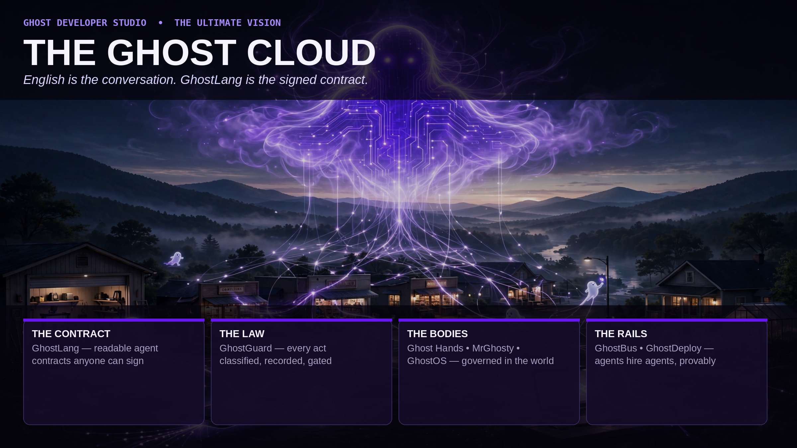
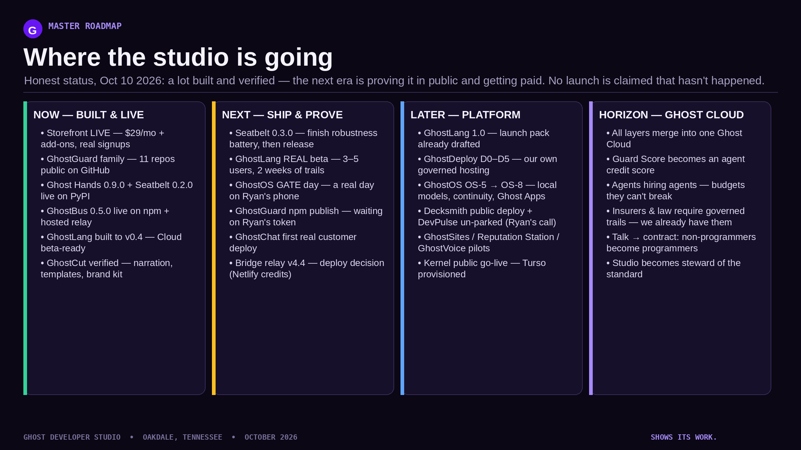
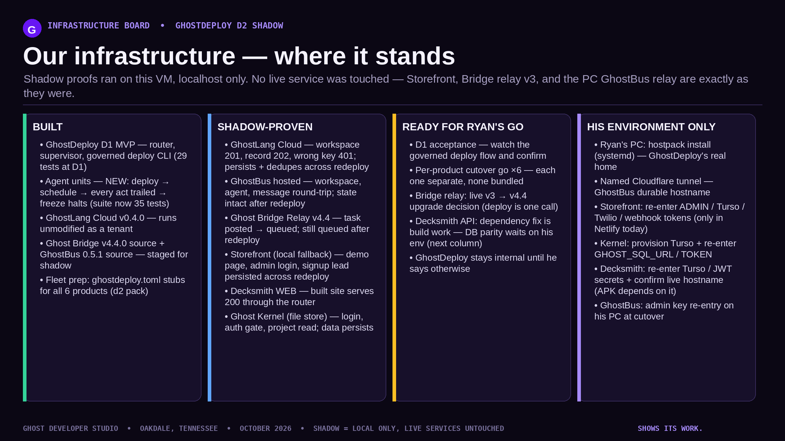
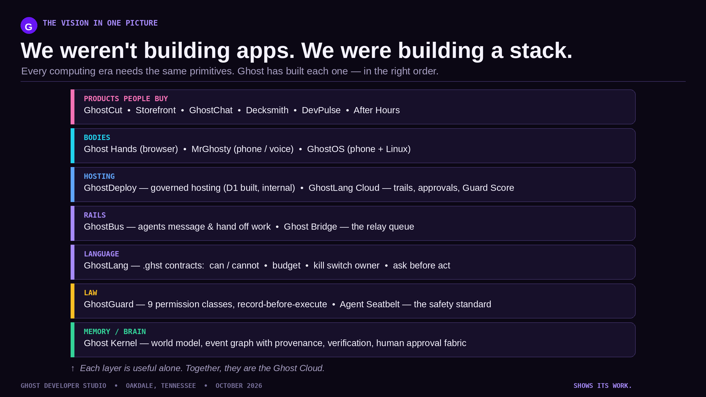
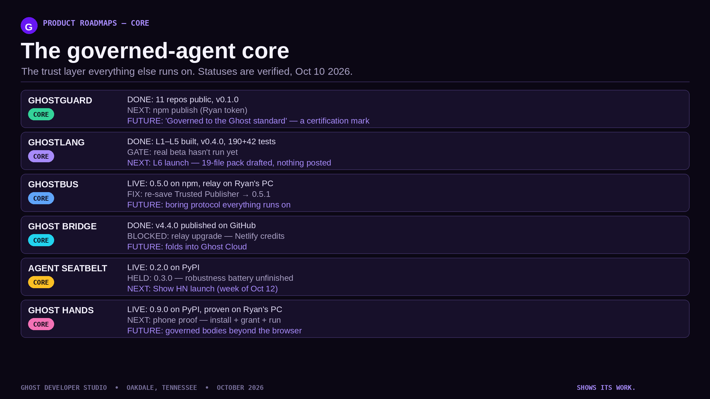
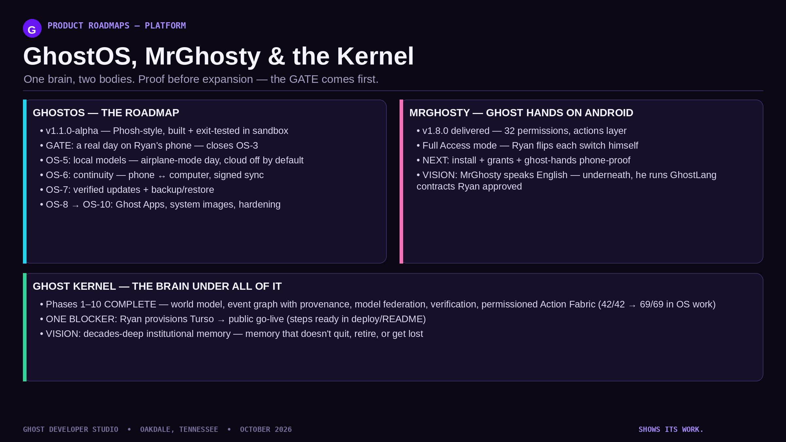
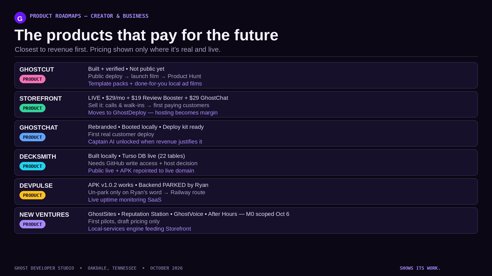
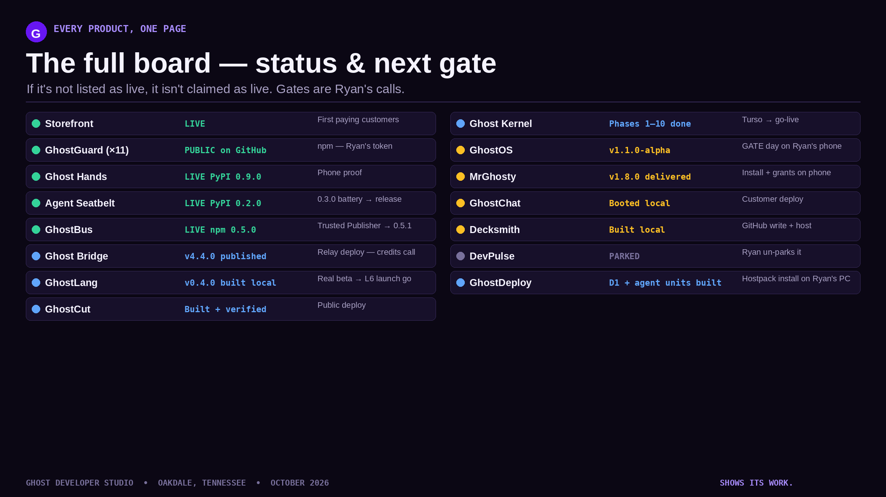

# Ghost Developer Studio — Roadmaps & The Ultimate Vision

**Oakdale, Tennessee · October 2026**

We weren't building apps. We were building a stack — and this is the map of it:
the master roadmap, a roadmap for every product, and the ultimate vision it all
adds up to: **the Ghost Cloud**.

> English is the conversation. GhostLang is the signed contract.

## The master roadmap

Now / Next / Later / Horizon — where the studio stands and where it is going.

## Infrastructure board — GhostDeploy D2 shadow

GhostDeploy D1 + agent units are built, and the six-product fleet has been
stood up in shadow (localhost only — no live service was touched).

## The stack

Every computing era needs the same primitives. Ghost has built each one, in the
right order: a kernel (memory/brain), a law (governance), a language, rails,
hosting, bodies — and the products people buy on top.

## Product roadmaps

### The governed-agent core
GhostGuard · GhostLang · GhostBus · Ghost Bridge · Agent Seatbelt · Ghost Hands

### Platform — GhostOS, MrGhosty & the Kernel
One brain, two bodies. Proof before expansion.

### Creator & business — the products that pay for the future
GhostCut · Storefront · GhostChat · Decksmith · DevPulse · new ventures

## The full board

Every product, its status, and its next gate — on one page. Statuses in this repo
are the verified studio status as of **October 10, 2026**.

## Portrait editions (9:16)

Phone-ready versions of every visual — TikTok, Reels, and wallpaper — live in
[`portrait/`](portrait/):

| File | Visual |
|---|---|
| `portrait/p1-ultimate-vision.png` | The Ghost Cloud poster |
| `portrait/p2-master-roadmap.png` | Master roadmap |
| `portrait/p3-the-stack.png` | The stack |
| `portrait/p4-core-governance-roadmap.png` | Governed-agent core |
| `portrait/p5-platform-roadmap.png` | GhostOS / MrGhosty / Kernel |
| `portrait/p6-creator-business-roadmap.png` | Creator & business |
| `portrait/p7-product-matrix.png` | The full board |

The clean vision artwork with no text is at
[`landscape/00-hero-vision-raw.png`](landscape/00-hero-vision-raw.png).

## The vision in one paragraph

Agents are becoming workers. Workers need contracts, law, rails, and bodies they
can be trusted inside. GhostLang is the readable contract — powers, limits,
budget, kill switch, owner. GhostGuard is the law underneath it, recording every
act before it executes. GhostBus is the rail agents hand work across. Ghost
Hands, MrGhosty, and GhostOS are the governed bodies. When those layers merge,
they form the Ghost Cloud: a place where other people's agents live and work —
and can prove, line by line, everything they did.

---

*Ghost Developer Studio — shows its work.*
